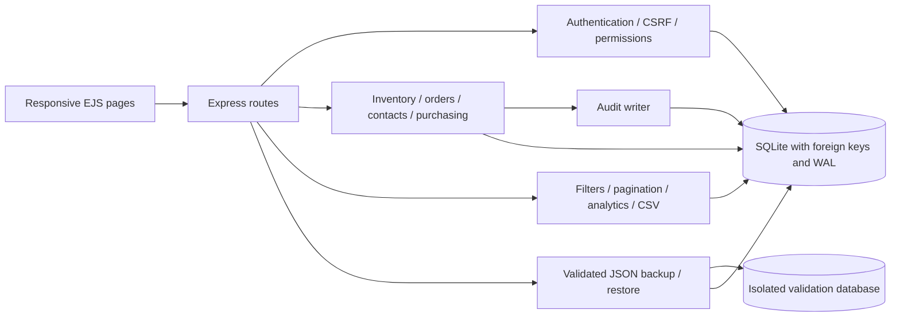
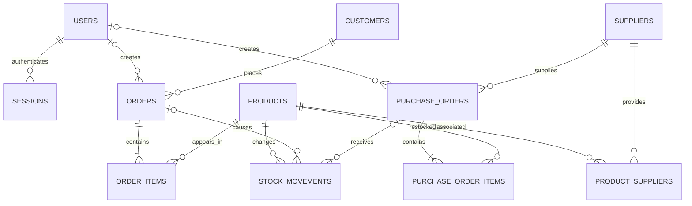

# Architecture and Database Design

## Application structure

`src/server.js` owns routes and view models. `auth.js` owns password hashing, sessions, CSRF, and access checks. Domain services own transactional mutations. `queries.js` owns parameterized filters, pagination, reports, and CSV serialization. `ui.js` provides rendering helpers and local SVG icons. `public/app.js` provides progressive UI behavior: search shortcuts, mobile navigation, stock dialogs, line-item forms, totals, and backup file loading.

## Relationships

`audit_logs` stores the actor ID/name, action, entity, details, and timestamp. Actor names and order customer names are snapshots, so later contact/account edits do not rewrite history. Audit actor IDs intentionally have no foreign key, allowing a restore event to retain the identity of the manager who initiated it even when that account is absent from the restored dataset.

## Integrity

- Schema migration is transactional and additive. Legacy order names are linked to customer records; missing opening stock is backfilled into the movement ledger.
- Every stock mutation goes through a shared movement writer that checks the resulting quantity, updates the product timestamp, and records the signed change and resulting balance.
- Immediate transactions serialize stock-changing writes. Sale confirmation, cancellation, and purchase receiving commit all lines and the audit event together.
- Cancellation accepts only `confirmed` sales orders; receipt/cancellation accepts only `pending` purchase orders.
- Sales use captured prices and integer-cent arithmetic when totaling. Quantities are bounded whole numbers. Unknown product/supplier associations and oversized totals are rejected.
- Query values are bound parameters; sort keys, table names, columns, and directions come from server-controlled allowlists.
- Pagination clamps page numbers and supports bounded page sizes. CSV applies the same filters without page limits.
- Reports reconstruct opening and closing inventory from the ledger. Valuation uses current product prices. Sales reflect current order status rather than booking cancellation revenue on the cancellation date.

## Authentication and access

First-run setup creates one manager. Passwords use random salts and scrypt with timing-safe verification. Sessions persist as SHA-256 hashes of 256-bit random cookie tokens, with eight-hour expiry. Cookies are HttpOnly and SameSite, and secure when the request is HTTPS. CSRF tokens are session-bound after login; anonymous setup/login forms use a random cookie token. Login attempts are limited per client IP. Role checks run on server routes, not only navigation. Disabling a user or changing access revokes that account’s sessions. Password changes revoke all of that user’s sessions.

## Restore

A backup is a versioned JSON snapshot of all business tables and user password hashes, excluding sessions. Restore checks the checksum, exact columns, scalar types, constraints, foreign keys, an active manager, movement balances, and order totals in a fresh in-memory database. After validation, it writes a private pre-restore safety file and replaces the data in one transaction. Sessions are revoked and a restore audit event is appended. A failed validation or import rolls back without partially replacing current records.

This architecture targets one local workspace, not a multi-tenant service. Partial purchase receipts and historical price accounting are not modeled.
