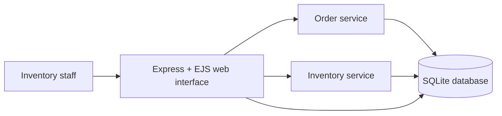
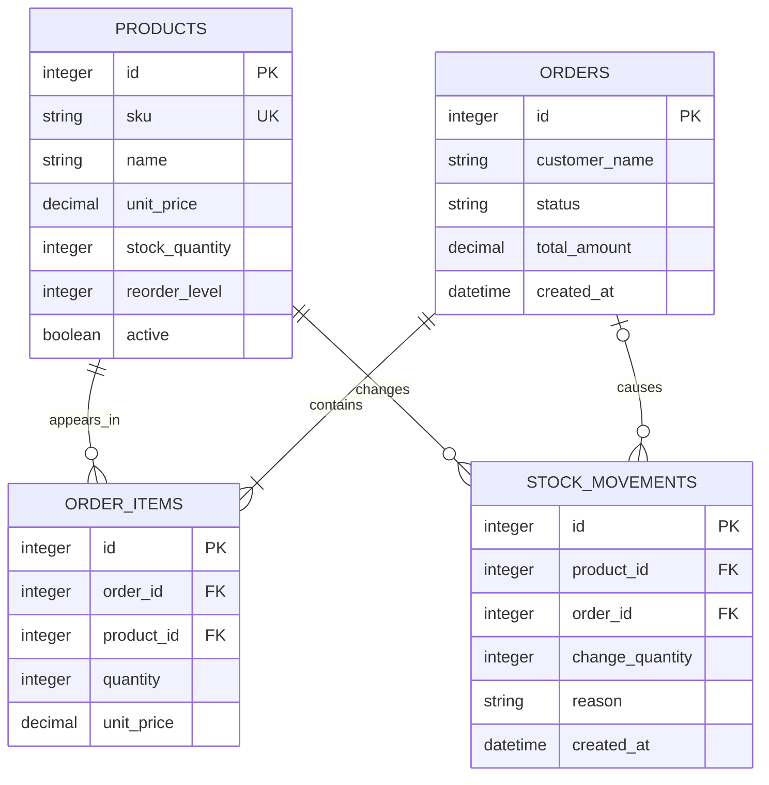

# Architecture and Database Design

## Application architecture

The Express server serves HTML views and accepts form submissions. The `orders` service owns transactional order confirmation; the `inventory` service owns product creation and restocking. SQLite is used because it is a persistent local database without an additional server to install.

## Entity relationships

## Integrity decisions

- Foreign keys are enabled for every database connection.
- Product SKUs are unique.
- Prices and stock quantities cannot be negative.
- Order confirmation aggregates duplicate product lines before validating stock.
- An order, its items, inventory deductions, and negative stock movements are written as one transaction; a failed validation leaves the database unchanged.
